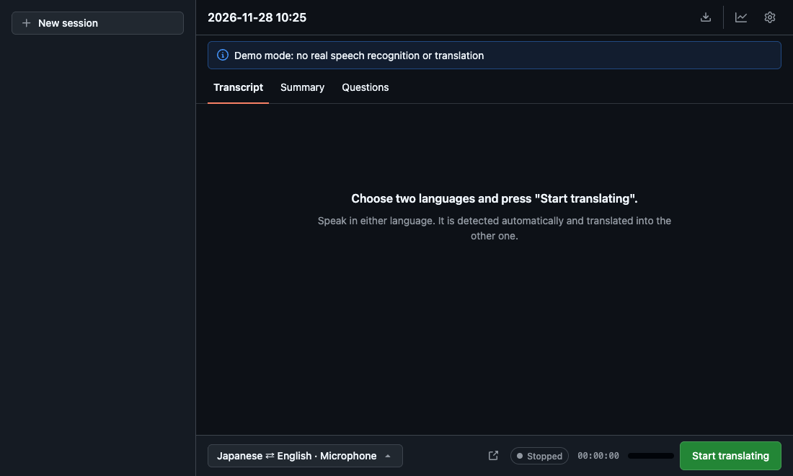
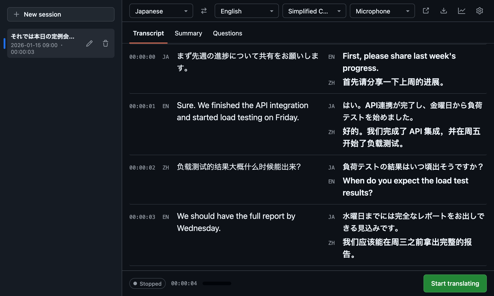
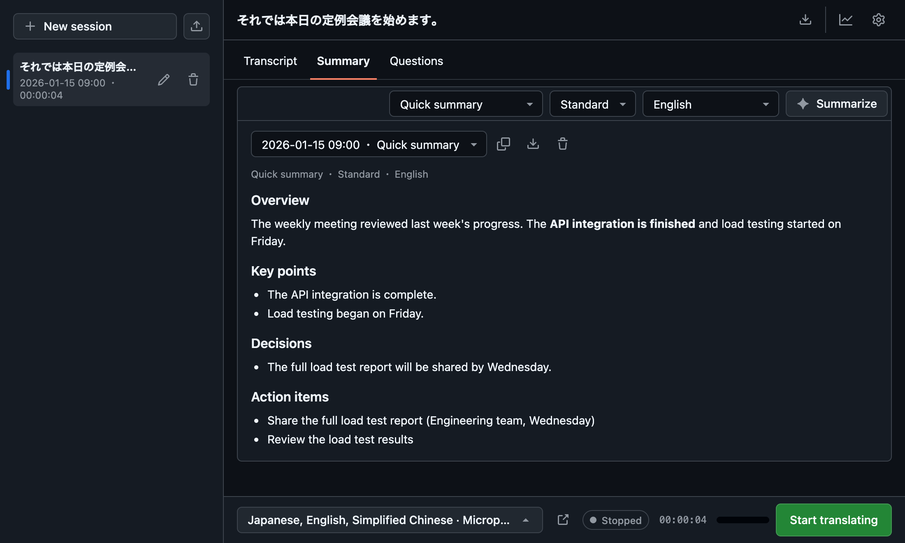
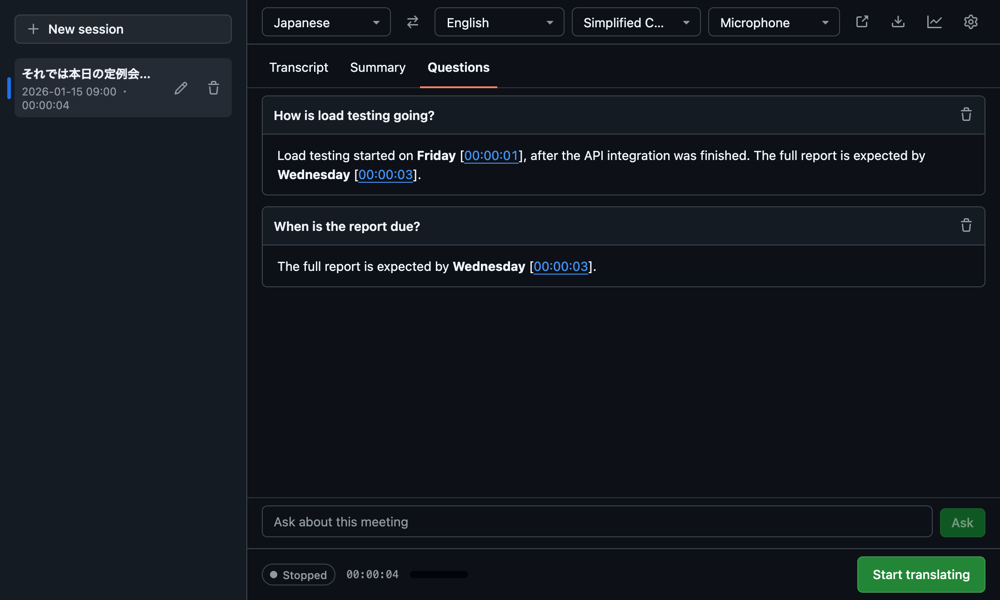

# Twinscript

[English](README.md) | 日本語

会議をリアルタイムで文字起こしし、2つ（または3つ）の言語のあいだで翻訳する、macOS / Windows 用のデスクトップアプリです。
言語を選んで「翻訳開始」を押すと、どの言語が話されているかを自動で判定して書き起こし、その横に訳文を表示します。
画面の表示言語は英語・日本語・中国語（簡体）に対応しています。



## できること

**会議中**

- 双方向: 選んだどの言語で話しても構いません。切り替えは不要です。
- マイク、PC で鳴っている音（Zoom / Teams / Meet の相手の声）、またはその両方を文字起こしします。
- [通訳者のやり方](#訳し方同時通訳にならった設計)で訳します。一度出した訳は書き換えず、続きを足していきます。
- スライドや会議アプリの上（全画面表示を含む）に出し続けられる字幕ウィンドウがあります。
- 確定した訳文を OS の音声で読み上げられます。
- 登録した社名や製品名を聞き取りやすくし、聞き間違いは「誤 => 正」のルールで直します。

**会議のあと**

- セッションを音声と一緒に保存し、文字起こしをテキスト / Markdown / CSV / SRT に書き出せます。
- テンプレートに沿って、選んだ長さと言語でセッションを要約します。
- 会議についての質問に、根拠にした文字起こしの行を示して答えます。
- 録音から話者を聞き分け、文字起こしの各行に誰が話したかを付けます。
- 録音から文字起こしを話者と翻訳つきで作り直せます。聞き取り時の文字起こしは残ります。
- ほかで録音した音声ファイルから、話者と翻訳つきのセッションを作れます。

**つくり**

- サーバーはありません。アプリが Google の Gemini API と直接やりとりします。API キーはあなた自身のもので、PC に暗号化して保存します。
- セッション、録音、設定は PC の中だけに保存します。
- 料金は使った分を Google に払います。有料枠では文字起こしが1時間で約 $0.54 です。無料枠もあります。

## インストール

[Releases](../../releases) から、お使いの PC に合った zip をダウンロードします。

| ファイル | 対象 |
| --- | --- |
| `twinscript-<バージョン>-mac-arm64.zip` | Apple シリコンの Mac |
| `twinscript-<バージョン>-mac-x64.zip` | Intel の Mac |
| `twinscript-<バージョン>-win-x64.zip` | Intel / AMD の Windows |
| `twinscript-<バージョン>-win-arm64.zip` | Arm の Windows（Snapdragon X など） |

各リリースには、ダウンロードしたファイルを照合するための `SHA256SUMS.txt` も付いています。アプリは Apple の公証を受けておらず、
Windows の発行元証明書での署名もしていない（[署名について](docs/code-signing-policy.md)）ため、初回に OS の警告が出ます。

- **macOS**: zip を展開して「Twinscript.app」をアプリケーションフォルダに移して開きます。
  「"Twinscript" Not Opened（開けませんでした）」と表示されます。ゴミ箱には入れず「完了（Done）」を押し、
  システム設定 → プライバシーとセキュリティ を下までスクロールして「このまま開く（Open Anyway）」を押すと、次から普通に開けます。
  ターミナルで `xattr -dr com.apple.quarantine "/Applications/Twinscript.app"` を実行しても同じです。
- **Windows**: zip を右クリック →「すべて展開」し、フォルダ内の「Twinscript.exe」を実行します。
  「Windows によって PC が保護されました」と出たら「詳細情報」→「実行」を押します。

続いて、[Google AI Studio](https://aistudio.google.com/apikey) で Gemini の API キーを発行し（[手順](docs/api-key.ja.md)）、
Twinscript の右上の設定（歯車のボタン）で入力して保存します。

新しいバージョンが公開されると、アプリは文字起こしの上にお知らせを出します。ボタンでそのリリースのページが開きます。
更新するには、新しい zip をダウンロードしてアプリを置き換えてください。お知らせを閉じると、そのバージョンについては
もう表示されません（次のバージョンはまた知らせます）。設定の「新しいバージョンを確認する」でオフにできます。

## 会議中に使う

言語と音声入力を選び、「翻訳開始」を押します。どの行も、行頭に言語を示す短いコード（JA、EN、ZH）が付きます。
話された原文にも、訳文にも付きます。

### 言語

3つの言語で話す会議では、3つ目の言語のメニュー（「+ 言語を追加」）でもう1つ選びます（もう一度選ぶと2言語に戻ります）。
どの文も残りの2つの言語に翻訳され、訳文は言語を示すタグを付けて1行ずつ並びます。日本語・英語・中国語の会議では次のようになります。



選んだどの言語でもない言語の発言は、選んだすべての言語に翻訳します。そのうち1つだけに翻訳するには、設定の
「選んだ言語以外が話されたときの訳し先」でその言語を選びます。2言語のときは、こうした発言を文字の種類で見分け（日本語と英語の
会議でのヒンディー語など）、2つの訳文をタグ付きで1行ずつ表示します。2つのどちらかと同じ文字を使う言語（英語を選んだときの
フランス語など）の発言は、1つ目の言語（設定で選んだときはその言語）に翻訳します。

### 音声入力

- **マイク**: その場で行う会議向けです。
- **PC音声**: PC で鳴っている音です。オンライン会議の相手の声に使います。
- **マイク＋PC音声**: 両方です。スピーカーの音をマイクが拾って二重になるので、イヤホンを使ってください。

macOS で PC音声を使うには、macOS 14.2 以降と許可がひとつ必要です。システム設定 → プライバシーとセキュリティ →
画面収録とシステムオーディオ録音 →「システムオーディオ録音のみ」で Twinscript を許可し、アプリを開き直します。
許可がないときは、どこで許可するかをアプリが表示します。すべてのリリースを同じ証明書で署名しているので、一度与えた許可は
アプリを更新しても保たれます。更新のあとで PC音声が無音のままになったり、許可を何度も求められたりする場合は、
「システムオーディオ録音のみ」（と「マイク」）の一覧から Twinscript を「−」ボタンで削除し、アプリを開いて許可し直してください。

### 字幕を他のアプリの上に重ねる

右上の字幕ウィンドウのボタンを押すと、字幕欄が枠なし・半透明のウィンドウに移り、全画面のスライドや会議アプリを含む
すべての手前に表示され続けます。ドラッグで移動し、× で閉じます。設定の「字幕」で、聞き取り中でもすぐに変えられます。

- **表示する内容**: 原文と訳文、または訳文のみ。訳文が届くまでは原文を表示します。メインウィンドウの字幕欄にも適用されます。
- **字幕ウィンドウの文字サイズ**: メインウィンドウの文字サイズとは別に設定します。
- **字幕ウィンドウの背景の不透明度**: 0〜100%。文字には暗い縁取りが付くので、どんな背景の上でも読めます。
- **字幕ウィンドウのクリックを下のアプリに通す**: オンの間は字幕ウィンドウをマウスで動かしたり閉じたりできないので、
  字幕ウィンドウのボタンか下のショートカットで隠します。

ブラウザでは字幕ウィンドウがピクチャー イン ピクチャーのウィンドウ（Chrome と Edge、常に不透明）になるため、最初の2つだけが使えます。

### 訳文の読み上げ

設定の「訳文の読み上げ」で選んだ言語（2言語のときは両方向も選べます）への訳文を、確定するたびに OS の音声で読み上げます。話している途中の文は
読み上げません。聞き取り中でもすぐに反映されます。3言語のときは1つの言語を選び、その言語への訳文だけを読み上げます（その言語で話された文は読み上げません）。
2言語のときは訳文の言語を文字の種類で見分けるため、日本語と英語のように使う文字が異なる組み合わせでだけ使えます。ヘッドホンを使ってください。スピーカーから流すとマイクが音声を拾い、もう一度文字起こしされてしまいます。

Windows のデスクトップアプリでは、PC音声を取り込んでいる間（「PC音声」または「マイク＋PC音声」）は読み上げを使えません。Windows の
PC音声は PC で鳴っている音すべてで、アプリ自身の読み上げも含むため、それをもう一度文字起こしして翻訳してしまうからです。設定で選んだ言語は残り、
音声入力をマイクに戻すとまた読み上げます。

### ショートカット

Twinscript が起動していれば、どのアプリからでも使えます。設定でオフにでき、他のアプリが同じキーを使っている場合は
設定に「他のアプリが使用中」と表示されます。キーは変更できません。

| 操作 | macOS | Windows |
| --- | --- | --- |
| 翻訳の開始 / 停止 | ⇧⌘T | Ctrl+Shift+T |
| 字幕ウィンドウの表示 / 非表示 | ⇧⌘C | Ctrl+Shift+C |

### 用語と置き換え

設定の「用語と置き換え」に社名や製品名を1行に1つずつ登録すると、聞き取りやすくなります。「誤 => 正」の形の行は、
文字起こしの聞き間違いを置き換えます。別の設定の「用語集・会議の背景」は[翻訳](#訳し方同時通訳にならった設計)に使います。

## 会議のあとで

- 左の一覧にセッションが並びます（新規作成・切り替え・名前変更・削除）。
- 文字起こしと訳文は自動で保存され、アプリを閉じても残ります。
- 音声も録音して保存します（設定でオフにできます。1時間で約15MB）。
- ダウンロードのボタンから、タイムライン付きの文字起こし（テキスト / Markdown の表 / CSV / 字幕 SRT、
  原文と訳文・原文のみ・訳文のみ）と録音を書き出せます。

### 要約

「文字起こし」タブの隣の「要約」タブで、終わったセッションを、テンプレート（クイック要約、エグゼクティブサマリー、議事録、
アクションアイテム、顧客との打ち合わせ、商談 (BANT)、1on1、朝会、または自分で作ったもの）に沿って AI がまとめます。
長さと、要約を書く言語も選べます。次の画面はクイック要約の例です。



作った要約はすべてセッションに残り、切り替えて読んだり、Markdown でコピーしたり、`.md` でダウンロードしたりできます。
自分のテンプレートは設定の「要約のテンプレート」で作成でき、JSON ファイルに書き出して読み込み直せます。

### 会議についての質問

セッションのあと、「質問」タブ（「要約」の隣）で、何が決まったか、誰が何をするか、数字はいくつだったかなどを質問できます。
質問を入力して Enter を押します（Shift+Enter で改行）。回答は届いた分から表示され、途中で止められます。次の画面は2つの質問に答えた例です。



- 回答は、セッションの文字起こし（話者を識別したあとは話者名つき）と要約、それまでの質問と回答をもとに、翻訳モデルが書きます。
  会議の中に答えがないときは、推測で補わずにそう答えます。回答は質問と同じ言語で書かれます。
- 回答には、根拠にした発言の時刻が [00:12:34] のように入ります。文字起こしにある時刻はリンクになり、押すと「文字起こし」タブの
  その行を表示して、しばらく印を付けます。
- 質問と回答はセッションに保存され、セッションと一緒に削除されます。1件ずつ削除することもできます。止めた質問や失敗した質問は
  保存されず、入力欄に残るので、そのまま聞き直せます。
- 文字起こしが長すぎて全部は送れないときは中ほどを省き、回答に「一部のみをもとにしている」旨の注記が付きます。

### 話者の識別

セッションのあと、「文字起こし」タブの、文字起こしの上にある「話者を識別」で、セッションの録音から話者を聞き分け、
文字起こしの各行に話者を付けます。名前は、話し始めた順に「話者1」「話者2」…となります。識別できるのは録音のあるセッションだけです。

- このために録音を Google の Gemini API（`gemini-3.5-transcribe`）にアップロードし、解析が終わるとすぐに削除します。解析に
  失敗したときや中止したときも削除します（アップロードの途中で中断されたファイルは、Google 側で2日後に自動で消えます）。初めて使うときに、このことを説明して一度だけ確認します。
- 進み具合（音声の準備、アップロード、パート 1/n の解析）を表示し、途中で中止できます。
- 「話者」で名前を編集できます。名前は、そのセッションでその話者のすべての行に使われます。行の話者名を押すと同じ画面が開き、
  その行の話者を直せます（「話者なし」にもできます）。
- 識別のあとに作った要約では、誰が発言・決定・担当するのかが名前で書かれます。識別の前に作った要約には「古い要約」の印が付きます。
  ダウンロードにも話者が入ります（`.txt` と `.srt` は本文の前、`.md` と `.csv` は専用の列）。
- 聞き分けられるのは8人までです。3人以上では精度が下がるので、各行を確認してください。
- 25分を超える録音はパートに分けて解析します。2つ目以降のパートの先頭には、それまでに見つかった話者の短い音声を付け、
  パートをまたいでも同じ話者に同じ名前が付くようにしています。対応付けが確実でないときは、推測せずにそのパートの該当する
  話者を「話者なし」にし、編集画面でその旨を表示します。
- もう一度識別すると、確認のうえ、話者・名前・手で直した内容を置き換えます。

### 録音から文字起こしを作り直す

聞き取り時の文字起こしは速さを優先して作るため、ライブのモデルが聞き間違えたり聞き落としたりした内容がそのまま残ります。
録音のあるセッションでは、終了後に「録音から作り直す」（話者の操作の隣）で、あとから文字起こしするモデル
（`gemini-3.5-transcribe`）で録音をもう一度文字起こしし、セッションの行を作り直せます。文ごとの行に時刻と話者が付き、
各行はセッションの言語にもう一度翻訳されます。

- 始める前に、変わることを表示します。行の言い回し・数・時刻が変わること、すべての行をもう一度翻訳すること、話者を
  もう一度識別すること、これまでの要約と回答に前の文字起こしから作ったことが示されること、録音をもう一度処理する料金と
  翻訳の料金がかかること、そのために録音をアップロードすることです。
- 録音は分割して送り、解析が終わるたびに Gemini API から削除します（話者の識別と同じです）。ここで同意すると話者の識別にも
  適用され、その逆も同じです。
- 進み具合（パート 1/n のアップロードと文字起こし、続いて翻訳した行の数）を表示し、中止できます。その間もセッションの
  ほかの部分は読めますが、話者の編集と、このセッションでの聞き取りの開始はできません。中止したときや失敗したときは、
  セッションは元のままです。
- 新しい行は、行と翻訳がそろった時点でまとめて置き換わります。翻訳に失敗した行には、聞き取り中と同じくエラーを表示します。
- 付けた話者名は、前の行の話者と確実に対応付けられる話者にだけ引き継ぎます。それ以外は既定の名前になります。
- 聞き取り時の文字起こしは翻訳と話者ごと保存されます。「聞き取り時の文字起こしに戻す」で元に戻すと、作り直した文字起こしは
  破棄されます。作り直した文字起こしをもう一度作り直したときも、聞き取り時の文字起こしは残り、作り直した分だけが置き換わります。
- セッションのタイトル、録音、これまでの利用量はそのままで、作り直しに使った分が加わります。

### 音声ファイルからセッションを作る

ほかで録音した会議（レコーダー、スマートフォン、オンライン会議からダウンロードした録音）を、セッションとして取り込めます。
「新しいセッション」の隣のボタンでファイルを選ぶと、文字起こしの作り直しと同じく、あとから文字起こしするモデル
（`gemini-3.5-transcribe`）で話者つきで文字起こしし、すべての行を翻訳します。

- 形式: WAV、MP3、M4A と MP4（AAC）、AAC、FLAC、Ogg、WebM。2 時間、2000 MB まで。Vorbis のファイル（Ogg や WebM の一部）は一度に全体を
  デコードするため、1 時間、500 MB まで。AIFF と CAF は読み込めません。
- セッションの言語は、ウィンドウ上部で選んでいる言語です。読み込む前に選んでください。
- 始める前に、ファイル名と長さ、言語、行うことを表示します。ファイルを分割して Gemini API にアップロードし、解析が終わるたびに
  削除すること、話者つきで文字起こしし、すべての行を翻訳すること、文字起こしモデルで録音を処理する料金とすべての行の翻訳の
  料金がかかること、音声を 16 kHz モノラルに変換してセッションの録音としてアプリに保存すること（元のファイルは保存しません）です。ここで同意すると話者の識別と文字起こしの
  作り直しにも適用されます。
- ダイアログに進み具合（ファイルの読み込み、パート 1/n のアップロードと文字起こし、翻訳した行の数）を表示し、キャンセルで
  中止できます。すべて終わるまで何も追加しません。中止したとき、失敗したとき、途中でアプリを閉じたときは、セッションも音声も
  残りません。失敗したときは理由を表示します（読めないファイル、無音や短すぎるファイル、音声が見つからない、API のエラー、
  レート制限）。
- 新しいセッションの名前はファイル名、日付は読み込んだ日時です（ファイル自体の日付は、最後にコピーや変換をした日時であって
  会議の日時とは限らないため）。長さはファイルの長さです。録音は 16 kHz モノラルの WAV に変換した音声（1 時間あたり約 115 MB）で、ほかの
  セッションと同じく、ダウンロード、話者の識別のやり直し、文字起こしの作り直しができます。
- 翻訳に失敗した行には、聞き取り中と同じくエラーを表示します。
- 聞き取り中とデモでは使えません。

## 訳し方（同時通訳にならった設計）

同時通訳者は、単語ごとには訳さず、一度言ったことは取り消さず、話の流れと事前に用意した用語を頼りに訳します。
Twinscript の翻訳は、この4つにならっています。

| 通訳者がすること | Twinscript がすること |
| --- | --- |
| 意味のまとまりで訳す | 発話を文の単位に切り出して、文ごとに訳します。長く話し続けても、文が終わるたびに訳が確定します。 |
| 言ったことは取り消さない | 話している途中の文は、画面に出ている訳を保ったまま、続きを足していきます。直すのは、続きを聞いて誤りと分かった部分だけです。文が終わった時点で、途中の訳がすでに文の最後まで届いていれば、訳し直さずにそのまま確定します。 |
| 話の流れを踏まえる | 直前の発話とその訳を文脈として渡し、指示語や言い回しをそろえます。 |
| 用語を事前に準備する | 登録した用語は認識に、用語集と会議の背景は翻訳に使います。 |

この訳し方は、実際の会議の録音で測って決めています。途中の訳を更新のたびに作り直す方式と比べて、
表示したあとで書き換わる文字は約4分の1です。測り方は [docs/tuning.md](docs/tuning.md) にあります。

## プライバシー

Twinscript にサーバーはありません。音声と文字は、あなた自身の API キーを使って、PC から Google の Gemini API へ直接送られます。
それ以外のデータはすべてお使いの PC のアプリ内に保存され、どこにも同期されません。

| 送るもの | 送り先 | いつ |
| --- | --- | --- |
| 取り込むよう選んだ音声と、認識した文字 | Gemini API | 聞き取り中（文字起こしと翻訳） |
| セッションの文字起こし（質問では、要約とそれまでの質問と回答も） | Gemini API | 要約を作るとき、質問するとき |
| セッションの録音、または読み込んだ音声ファイル（解析のあとに削除） | Gemini API（Files API） | 話者を識別するとき、文字起こしを作り直すとき、音声ファイルを読み込むとき（音声は 16 kHz モノラルに変換して、セッションの録音としてコンピュータに保存されます） |
| 最新バージョンの番号の問い合わせ（あなたやセッションの情報は送りません） | GitHub | デスクトップアプリで、多くても 1 日に 1 回。「新しいバージョンを確認する」がオフなら送りません |

API キーは OS の機能で暗号化して PC 内に保存されます（macOS はキーチェーン、Windows は DPAPI）。暗号化できない環境では保存せず、
次回また入力を求めます。macOS では、暗号化の鍵がキーチェーンの「Twinscript Safe Storage」という項目に入ります。
Twinscript による使用を許可するか macOS に尋ねられたら、「常に許可」を選んでください。アプリがこの項目を使うのは、API キーの読み出しと保存のときだけです。

リアルタイムの文字起こしでは、API キーはリクエストのヘッダーでだけ送られ、接続ごとに使い捨ての短時間有効なトークンを取得するのに
使われます。キーが接続先のアドレスに入ることはありません。Google のトークンの仕組みが使えないときは、そのセッションの間はキーを
アドレスに入れて接続し、開発者コンソールに警告を出します。

- Gemini の無料枠では、送信した内容が Google の製品改善に使われます。社外秘の会議では有料のキーを使ってください。
- 他の人を録音・文字起こしするには、相手の同意が必要な場合があります。

## 料金

文字起こしと翻訳のモデルは無料枠で動きます（レート制限があります）。有料枠（Google Cloud の課金に紐づけたキー）では
送信内容は学習に使われず、料金は次のとおりです。

| 項目 | 料金 |
| --- | --- |
| 文字起こし | 約 $0.009/分（1時間で約 $0.54） |
| 翻訳 | リクエストごとの少額のトークン料金。複数の言語に翻訳する文は、言語の数だけリクエストがかかります。3つ目の言語を選んだときのすべての文と、選んでいない言語の発話を選んだすべての言語に翻訳するときが該当します |
| 話者の識別（`gemini-3.5-transcribe`） | 入力 100万トークンあたり $2.00（音声1分あたり約 $0.003）、単語ごとの時刻つきの文字起こしの出力 100万トークンあたり $12.00。送る音声は録音より少し長くなります（2つ目以降のパートの先頭に付ける話者の音声と、長い録音のパートどうしの1分の重なり） |
| 文字起こしの作り直し | 録音の処理に話者の識別と同じ料金と、すべての行の翻訳のリクエスト（翻訳先が複数ある行はその数だけ） |
| 音声ファイルの読み込み | ファイルの長さについて、文字起こしの作り直しと同じ |
| 要約と質問 | 翻訳モデルのトークン料金。1件につき1回のリクエストで、入力の大半はセッションの文字起こしです。長い会議ほど1回の質問の料金も上がります |

金額は執筆時点のものです。最新の料金は Google の[料金表](https://ai.google.dev/gemini-api/docs/pricing)を見てください。

### 利用量と料金

ヘッダーのグラフのボタンで、使った量とその料金の推定（米ドル）を開けます。表示中のセッション（聞き取り時間、翻訳・要約・話者の識別・質問の
リクエスト数とトークン数）、今日・今月・先月・記録したすべての合計、保存した各セッションの一覧です。

- 聞き取り時間は文字起こしに接続している間を数えます。翻訳・要約・話者の識別・質問は、リクエストごとに API が返すトークン数で数えます。
  文字起こしの作り直しは、録音の処理を話者の識別として、行の翻訳を翻訳として数えます。途中で中止したときや失敗したときも、
  それまでのリクエストの分は数えます。読み込んだ音声ファイルも同じく新しいセッションに数えます（中止したときや失敗したときは
  日ごとの合計にだけ数えます）。
  利用量の記録がないセッションは「記録なし」と表示します。
- 合計はアプリ内に日ごと（直近 400 日分）に残り、セッションを削除しても消えません。デモ（`?mock=1`）のセッションには
  架空の利用量を表示しますが、合計には加えません。
- 金額は、アプリに記載した有料枠の価格（取得した日付つき）による推定です。無料のキーでは料金はかかりません。実際の請求は
  Google の課金に従います。
- 価格は 設定 → 推定に使う価格 で変えられます。価格が変わったときや、別の翻訳モデルを使うとき（価格を追加するまでは
  「価格なし」）に使います。「既定値に戻す」で記載の価格に戻ります。

## 制限

- 話者の識別、文字起こしの作り直し、質問は、セッションのあとにだけ使えます。聞き取り中にはできません。回答は文字起こしをもとにするため、
  聞き間違えた内容は聞き間違えたまま答えます。大事なところは、示された行を確認してください。
- 作り直した文字起こしは録音以上のものにはなりません。録音していない部分（録音をオフにしていた、読み込めない部分がある）は
  含まれません。翻訳には、作り直しを始めた時点の「選んだ言語以外が話されたとき」の設定を使います。
- 文字起こしを作り直したり元に戻したりすると、それより前の回答で示された時刻が同じ行を指さないことがあります。
- 読み込んだ音声ファイルは、あとから文字起こしするため、リアルタイムの字幕はありません。2 時間または 2000 MB を超えるファイルは
  読み込めません。ファイルは少しずつ読んでデコードし、2 時間の読み込みで約 1.3 GB のメモリを使います。Vorbis の
  ファイルは一度に全体をデコードし、ステレオ 1 時間で数 GB を使うため、1 時間、500 MB までです。元のファイルは
  保存せず、録音は 16 kHz モノラルに変換した音声です。
- 文字起こしの接続は最長10分のため、発話の切れ目で裏側の接続を自動で切り替えています。
- 無料枠でレート制限に当たると、途中の文の翻訳を1分間止め、確定した文の翻訳だけ続けます。
- 3つ目の言語を選んでいるとき、文の言語は文字の種類で判定します。選んだ別の言語と同じ文字を使う言語（英語とフランス語、
  簡体字と繁体字の中国語など）は、翻訳モデルが判別します。その文ではリクエストが1回増えます。選んでいない言語でも、選んだ言語と
  同じ文字で書くもの（ラテン文字の言語が英語だけのときのフランス語など）は、その言語として扱います。
- Windows のデスクトップアプリでは、PC音声を取り込んでいる間は訳文を読み上げません（[理由](#訳文の読み上げ)）。
- 録音ファイル（WebM）は再生時間の情報を持たないため、プレーヤーによってはシークできません。

## 仕組み

| 役割 | 使用モデル |
| --- | --- |
| 文字起こし（途中経過つきストリーミング） | Gemini Live API `gemini-3.5-transcribe-live` |
| 翻訳（ストリーミング） | `gemini-3.5-flash-lite`（設定で変更可） |
| 要約と会議についての質問 | 翻訳モデル |
| 話者の識別と文字起こしの作り直し（セッションのあと、録音から） | `gemini-3.5-transcribe` |

アプリは Web の技術で作り、Electron でパッケージしています。実行時に使うライブラリは [Mediabunny](https://github.com/Vanilagy/mediabunny)（MPL-2.0）ひとつで、
音声ファイルを少しずつ読むのに使います。音声のデコードはブラウザ自身のデコーダが行います。

## 開発

```sh
npm install
npm run app        # デスクトップアプリを起動
npm run dist:mac   # dist/ に macOS 用 zip（Apple シリコン / Intel）
npm run dist:win   # dist/ に Windows 用 zip（x64 と arm64）
npm start          # ブラウザで画面を開く（http://localhost:5173）
npm test           # 単体テスト。依存なしで動きます
npm run test:e2e   # ブラウザでの通しテスト。インストール済みの Chrome と偽マイクを使います
npm run test:app   # デスクトップアプリの起動確認。実際にウィンドウが開きます
```

どのテストも Gemini の API は模擬しているので、API キーは不要です。`http://localhost:5173/?mock=1` も API キーなしで動く
デモモードです。デモには話者の識別、文字起こしの作り直し、音声ファイルの読み込みはありません（実際のサービスが必要なため）。ブラウザでは、PC音声はタブや画面を音声付きで
共有して取り込みます。そこで入力した API キーはメモリ上にだけ置かれ、ページを閉じると消えます。

## 質問・要望・予定

- 質問と要望: [Discussions](https://github.com/pideoh/twinscript/discussions)
- 不具合: [Issues](https://github.com/pideoh/twinscript/issues)
- 予定しているもの、進行中のもの、済んだもの: [プロジェクトボード](https://github.com/users/pideoh/projects/1)

## 開発に参加する

[CONTRIBUTING.md](CONTRIBUTING.md) を見てください。セキュリティ上の問題の報告は [SECURITY.md](SECURITY.md) にあります。

## ライセンス

[MIT](LICENSE)

画面には Primer Primitives のデザイントークンと Octicons のアイコンを使っています（どちらも MIT、© GitHub Inc.）。詳しくは [THIRD-PARTY-NOTICES.md](THIRD-PARTY-NOTICES.md) を見てください。
