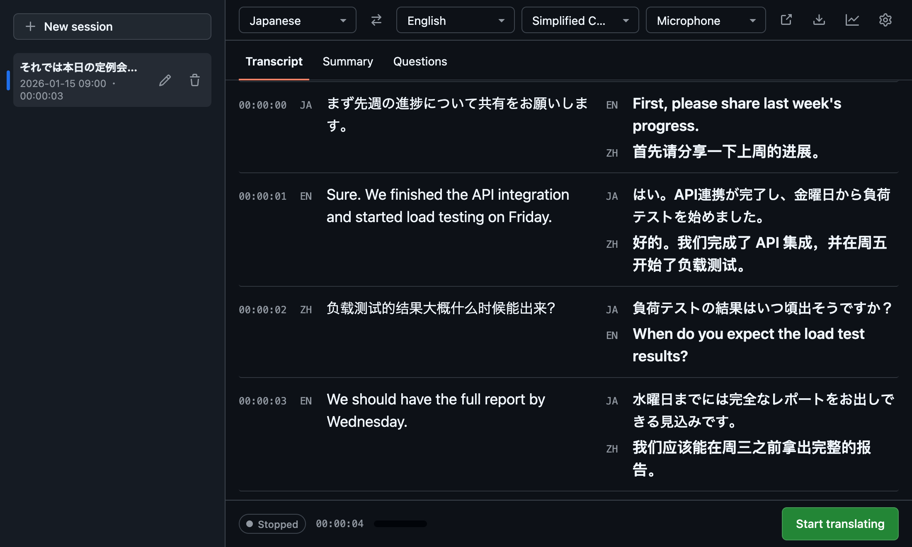

# Twinscript

English | [日本語](README.ja.md)

A desktop app for macOS and Windows that transcribes a meeting in real time and translates it between two languages,
or three. Choose the languages and press "Start translating": Twinscript detects which one is being spoken, writes it
down and shows the translation beside it. The interface is available in English, Japanese and Simplified Chinese.


## What it does

**During the meeting**

- Two-way: speak in any of the selected languages, with no switching.
- Hears the microphone, the audio playing on the computer (the other participants in Zoom, Teams, Meet), or both.
- Translates [the way an interpreter does](#how-it-translates-modeled-on-simultaneous-interpreting): what is shown is continued, not rewritten.
- Shows captions in a window that stays above slides and meeting apps, including full screen.
- Reads finished translations aloud with your system's voices.
- Recognizes the company and product names you register, and corrects mishearings with `wrong => right` rules.

**After the meeting**

- Keeps each session with its audio, and exports the transcript as text, Markdown, CSV or SRT.
- Summarizes a session with a template, at the length and in the language you choose.
- Answers questions about the meeting, citing the lines of the transcript it relies on.
- Tells the speakers apart from the recording and labels each line with who said it.
- Makes the transcript again from the recording, with speakers and translations, keeping the one made while listening.

**How it is built**

- No server: the app talks to Google's Gemini API directly, with your own API key, stored encrypted on your computer.
- Sessions, recordings and settings are stored on your computer only.
- You pay Google for what you use: transcription is about $0.54 an hour on the paid tier, and there is a free tier.

## Install

Download the zip for your computer from [Releases](../../releases):

| File | For |
| --- | --- |
| `twinscript-<version>-mac-arm64.zip` | Mac with Apple silicon |
| `twinscript-<version>-mac-x64.zip` | Mac with an Intel processor |
| `twinscript-<version>-win-x64.zip` | Windows on an Intel or AMD processor |
| `twinscript-<version>-win-arm64.zip` | Windows on Arm (Snapdragon X and the like) |

Each release also has a `SHA256SUMS.txt` to check the download against. The app is not notarized by Apple or signed
with a Windows publisher certificate ([signing](docs/code-signing-policy.md)), so the system warns the first time:

- **macOS**: unzip it, move "Twinscript.app" to the Applications folder and open it.
  It shows "\"Twinscript\" Not Opened". Do not move it to the Trash; press "Done", then scroll to the bottom of
  System Settings → Privacy & Security and press "Open Anyway". After that it opens normally.
  Running `xattr -dr com.apple.quarantine "/Applications/Twinscript.app"` in Terminal does the same.
- **Windows**: right-click the zip → "Extract All" and run "Twinscript.exe" in the folder.
  If "Windows protected your PC" appears, press "More info" → "Run anyway".

Then create a Gemini API key in [Google AI Studio](https://aistudio.google.com/apikey)
([step by step](docs/api-key.md)), open Twinscript, open the settings (gear button, top right), enter the key and save.

When a newer version is released, the app says so in a notice above the transcript, with a button that opens its
release page. To update, download the new zip and replace the app with it. Close the notice to hear no more about that
version; the next one is announced again. "Check for new versions" in the settings turns this off.

## During a meeting

Choose the languages and the audio input, then press "Start translating". Each line starts with a short code for its
language (JA, EN, ZH), for what was said and for its translations.

### Languages

For a meeting in three languages, pick one more in the third language menu ("+ Add a language"; choosing it again goes
back to two). Every sentence is then translated into the other two, each translation on its own line with a tag for
its language, as in this meeting in Japanese, English and Chinese:



Speech in a language that is none of the selected ones is translated into all of them. To have it translated into one
of them only, choose that language under "When a language other than the selected ones is spoken, translate into" in
settings. With two languages, the app recognizes such speech by its writing system (Hindi in a Japanese and English
meeting) and shows both translations, each on its own tagged line; speech in a language written like one of the two
(French when English is selected) is translated into the first language, or into the one chosen in settings.

### Audio input

- **Microphone**: for a meeting in the room.
- **PC audio**: what is playing on the computer, for the other side of an online meeting.
- **Microphone + PC audio**: both. The microphone also picks up the speakers, so use earphones.

On macOS, PC audio needs macOS 14.2 or later and one permission: allow Twinscript in
System Settings → Privacy & Security → Screen & System Audio Recording → "System Audio Recording Only", then reopen the app.
If the permission is missing, the app tells you where to allow it. Permissions are kept when you update, because every
release is signed with the same certificate. If PC audio stays silent or macOS keeps asking after an update, remove
Twinscript from "System Audio Recording Only" (and "Microphone") with the − button, then open the app and allow it again.

### Captions on top of other apps

The caption window button (top right) moves the caption area into a frameless, translucent window that stays on top of
everything else, including full-screen slides and meeting apps. Drag it to move it; close it with ×. The "Captions"
group in settings changes it while you listen:

- **Show**: source and translation, or translation only. A sentence shows its source until its translation arrives.
  This applies to the caption area in the main window too.
- **Caption window text size**, separate from the text size of the main window.
- **Caption window background opacity**, 0 to 100%. The text keeps a dark outline, readable over any background.
- **Let clicks pass through the caption window**: clicks go to the app underneath. While it is on, the caption window
  cannot be moved or closed with the mouse; hide it with the caption window button or the shortcut below.

In a browser the caption window is a picture-in-picture window (Chrome and Edge), which is always opaque, so only the
first two apply.

### Reading translations aloud

"Read translations aloud" in settings speaks each finished translation into the language you choose (or, with two
languages, into both) with the voices of your operating system; sentences still being spoken are not read. It takes
effect at once, also while listening. With three languages you choose one of them, and only the translations into it
are read; sentences spoken in that language are not. With two languages it needs different writing systems (such as
Japanese and English), because that is how the app tells which language a translation is in. Use headphones: from
speakers, the microphone picks up the voice and transcribes it again.

In the desktop app on Windows, reading aloud is not available while PC audio is captured ("PC audio" or
"Microphone + PC audio"): PC audio there is everything the computer plays, the app's own voice included, so the app
would transcribe and translate it again. The choice in settings is kept and applies again with the microphone.

### Shortcuts

These work from any app while Twinscript is running. They can be turned off in settings, which also show a shortcut
as unavailable when another app already uses it. The keys cannot be changed.

| Action | macOS | Windows |
| --- | --- | --- |
| Start / stop translating | ⇧⌘T | Ctrl+Shift+T |
| Show / hide the caption window | ⇧⌘C | Ctrl+Shift+C |

### Terms and corrections

Register company and product names, one per line, under "Terms and corrections" in settings, so that they are
recognized; a line `wrong => right` corrects a mishearing in the transcript. The glossary and meeting background,
a separate setting, are used [for translation](#how-it-translates-modeled-on-simultaneous-interpreting).

## After a meeting

- The list on the left holds your sessions: create, switch, rename, delete.
- Transcripts and translations are saved automatically and are still there after you close the app.
- The audio is recorded and saved too (can be turned off in settings; about 15 MB per hour).
- The download button exports the transcript with a timeline (text / Markdown table / CSV / SRT subtitles; source and
  translation, source only, or translation only) and the recordings.

### Summaries

The Summary tab, next to the Transcript tab, summarizes a finished session with a template: quick summary, executive
summary, meeting minutes, action items, customer meeting, sales call (BANT), 1:1, stand-up, or your own. You choose
the length and the language it is written in. Here it shows a quick summary:


Every summary is kept with the session, so you can switch between them, copy one as Markdown or download it as `.md`.
Your own templates are written under "Summary templates" in the settings, and export to and import from a JSON file.

### Questions about a meeting

After a session, the Questions tab (next to Summary) answers questions about it: what was decided, who will do what,
what a number was. Type a question and press Enter (Shift+Enter for a new line); the answer is written as it arrives
and can be stopped. Here it has answered two questions:


- Answers are written by the translation model from the session's transcript (with speaker names once the speakers are
  labeled), its summaries and the earlier questions and answers. When the meeting does not contain the answer, the
  answer says so instead of filling the gap. It is written in the language of the question.
- An answer gives the time of each line it relies on, such as [00:12:34]. Each time that is in the transcript is a
  link: it opens the Transcript tab at that line and marks it for a moment.
- Questions and answers are saved with the session and deleted with it; each one can be deleted on its own. A question
  that was stopped or failed is not saved and stays in the field to ask again.
- A transcript too long to send whole is shortened in the middle, and the answer carries a note that it is based on
  only part of the meeting.

### Speaker labels

After a session, "Label speakers" (in the Transcript tab, above the transcript) tells the speakers apart from the
session's recording and labels each line of the transcript with its speaker: "Speaker 1", "Speaker 2", … in the order
they first speak. Only sessions with a recording can be labeled.

- The recording is uploaded to Google's Gemini API for this (`gemini-3.5-transcribe`) and deleted there as soon as it
  has been analyzed, also when the analysis fails or is cancelled (a file whose upload was interrupted is removed by
  Google on its own after two days). The app explains this and asks once before the first use.
- Progress is shown per step (preparing the audio, uploading, analyzing part 1 of n) and it can be cancelled.
- "Speakers" opens the names: a name applies to every line of that speaker in the session. Activating the name on a
  line opens the same editor, where that line's speaker can be corrected (or set to none).
- Summaries made afterwards name who said, decided or will do what; a summary made before the labels is marked
  outdated. Downloads carry the speaker: before the text in `.txt` and `.srt`, in a column of its own in `.md` and
  `.csv`.
- Up to 8 speakers can be told apart; with three or more the result is less reliable, so check the lines.
- A recording longer than 25 minutes is analyzed in parts. Each part starts with short clips of the speakers found so
  far, so that a speaker keeps one label across parts. When that match is not certain, the speakers concerned are left
  without a label in that part rather than guessed, and the editor says so.
- Labeling again replaces the labels, names and corrections, after asking.

### Rebuilding the transcript from the recording

The transcript made while listening is made fast, and keeps what the live model misheard or missed. After a session
with a recording, "Rebuild from recording" (next to the speaker tools) transcribes the recording again with the model
that transcribes after the fact (`gemini-3.5-transcribe`) and makes the session's lines anew from it: sentence-sized
lines with their times and their speakers, each translated again into the session's languages.

- Before it starts, the app says what changes: the wording, number and times of the lines; every line is translated
  again; speakers are labeled again; summaries and answers made earlier are marked as made from an earlier
  transcript; it costs one more pass over the recording and the translations; the recording is uploaded for it.
- The recording is sent in parts and deleted from the Gemini API after each analysis, as for speaker labels; agreeing
  here also covers speaker labels, and the reverse.
- Progress is shown (uploading and transcribing part 1 of n, then the lines translated so far) and it can be
  cancelled. Meanwhile the rest of the session can be read, but its speakers cannot be edited and listening to it
  cannot be started. A cancelled or failed rebuild leaves the session as it was.
- The new lines replace the old ones all at once, when they and their translations are ready. A line whose translation
  failed shows its error, as while listening.
- Speaker names you gave are kept for a speaker who can be matched with certainty to one of the earlier lines'
  speakers; otherwise the default name is shown.
- The transcript made while listening is kept, with its translations and speakers. "Restore the transcript made while
  listening" puts it back and drops the rebuilt one. Rebuilding a rebuilt transcript keeps the one made while
  listening and replaces only the rebuilt one.
- The session's title, recording and earlier usage stay as they are; what the rebuild used is added.

## How it translates (modeled on simultaneous interpreting)

A simultaneous interpreter does not translate word by word, does not take back what has been said, and relies on the
flow of the conversation and on terms prepared beforehand. Twinscript's translation follows these four habits.

| What an interpreter does | What Twinscript does |
| --- | --- |
| Translates in units of meaning | Cuts speech into sentences and translates each one. However long someone talks, a translation is settled every time a sentence ends. |
| Does not take back what was said | While a sentence is being spoken, the translation on screen is kept and continued. Only what the rest of the sentence shows to be wrong is changed. When a sentence ends and the translation in progress already covers all of it, that translation is kept as it is instead of being requested again. |
| Follows the conversation | The preceding remarks and their translations are passed along as context, so references and wording stay consistent. |
| Prepares terms beforehand | The terms you register are used for recognition; your glossary and the background of the meeting are used for translation. |

This way of translating was chosen by measuring it on a recording of a real meeting. Compared with redoing the
translation of a sentence at every update, about a quarter as much shown text is rewritten afterwards.
[docs/tuning.md](docs/tuning.md) describes how it is measured.

## Privacy

Twinscript has no server. Audio and text go directly from your computer to Google's Gemini API with your own API key.
Everything else is stored on your computer, inside the app, and is not synced anywhere.

| What is sent | Where | When |
| --- | --- | --- |
| The audio you chose to capture, and the recognized text | Gemini API | While listening, for transcription and translation |
| The session's transcript (for questions, also its summaries and the earlier questions and answers) | Gemini API | When you make a summary or ask a question |
| The session's recording, deleted after the analysis | Gemini API (Files API) | When you label speakers or rebuild the transcript |
| A request for the number of the latest version; nothing about you or your sessions | GitHub | Desktop app, at most once a day, unless "Check for new versions" is off |

The API key is stored on your computer, encrypted by the operating system (the Keychain on macOS, DPAPI on Windows).
If the system cannot encrypt it, the key is not saved and the app asks for it again the next time. On macOS the
encryption key lives in the Keychain, in an item named "Twinscript Safe Storage". If macOS asks whether Twinscript may
use it, choose "Always Allow"; the app uses it only to read and save your API key.

For the live transcription, the key is sent only in a request header, to obtain a single-use, short-lived token for each
connection; the key is not placed in the connection's address. If Google's token service is unavailable, the app
connects with the key in the address instead for the rest of the session and logs a warning to the developer console.

- On Gemini's free tier, what you send is used to improve Google's products. Use a paid key for confidential meetings.
- Recording or transcribing other people may require their consent.

## Pricing

The free tier runs the transcription and translation models, with rate limits. On the paid tier (a key linked to
Google Cloud billing), what you send is not used for training, and the prices are:

| What | Price |
| --- | --- |
| Transcription | about $0.009 per minute (about $0.54 per hour) |
| Translation | a small token fee per request. A sentence translated into several languages takes one request per language: every sentence with a third language, and speech in a language you did not select when it goes into all of them |
| Speaker labels (`gemini-3.5-transcribe`) | $2.00 per 1M input tokens (about $0.003 per minute of audio) and $12.00 per 1M output tokens for the transcript with word times. The audio sent is somewhat longer than the recording: each part after the first starts with clips of the known speakers, and parts of a long recording overlap by a minute |
| Rebuilding a transcript | the price of speaker labels for the pass over the recording, plus a translation request for every line (one per target language where a line has several) |
| Summaries and questions | the translation model's token fee; one request each, its input mostly the session's transcript, so a long meeting costs more per question than a short one |

These are the prices at the time of writing; Google's [pricing page](https://ai.google.dev/gemini-api/docs/pricing) has the current ones.

### Usage and cost

The graph button in the header opens what was used and an estimate of its cost in US dollars: for the session on
screen (listening time, translation, summary, speaker-label and question requests and their tokens), totals for today,
this month, last month and everything recorded, and each saved session.

- Listening time is counted while the transcription is connected; translations, summaries, speaker labels and
  questions by the tokens the API reports for each request. A rebuilt transcript is counted as speaker labels (the pass
  over the recording) and translation (its lines), also when it is cancelled or fails after requests were made. A session without a usage record shows "Not recorded".
- The totals are kept in the app per day (the last 400 days) and stay when a session is deleted. The demo (`?mock=1`)
  shows made-up usage for its sessions and never adds it to the totals.
- Amounts are estimates at the paid-tier prices listed in the app, with the date they were taken. With a free key
  nothing is charged. Google's billing is what counts.
- The prices can be changed in Settings → Prices for estimates, for example when they change or when you use another
  translation model, which has no price until you add one. "Reset to defaults" brings back the listed prices.

## Limitations

- Speaker labels, rebuilding the transcript and questions work only after a session, not while listening. Answers
  come from the transcript, so what was misheard is answered as heard; check a cited line when it matters.
- A rebuilt transcript is only as good as the recording: speech that was not recorded (recording turned off, a part
  that cannot be decoded) is missing from it. Its translations use the setting for other languages as it is when the
  rebuild starts.
- After a transcript is rebuilt or restored, a time cited in an earlier answer may no longer point at the same line.
- A transcription session lasts at most 10 minutes, so the app switches to a new connection in the background, at a pause in speech.
- When the free tier hits its rate limit, translation of sentences in progress pauses for a minute; finished sentences are still translated.
- With a third language, the language of a sentence is told from its writing system. Languages that share it with
  another selected one (such as English and French, or Simplified and Traditional Chinese) are told apart by the
  translation model, which takes one more request for such a sentence. A language that is not selected but is written
  like a selected one (French when only English uses the Latin alphabet) is taken for that one.
- In the desktop app on Windows, translations are not read aloud while PC audio is captured ([why](#reading-translations-aloud)).
- Recordings (WebM) carry no duration information, so some players cannot seek in them.

## How it works

| Role | Model |
| --- | --- |
| Transcription (streaming, with interim results) | Gemini Live API `gemini-3.5-transcribe-live` |
| Translation (streaming) | `gemini-3.5-flash-lite` (can be changed in settings) |
| Summaries and questions about a meeting | the translation model |
| Speaker labels and rebuilt transcripts (after a session, from its recording) | `gemini-3.5-transcribe` |

The app is built with web technology and packaged with Electron.

## Development

```sh
npm install
npm run app        # run the desktop app
npm run dist:mac   # macOS zips in dist/ (Apple silicon / Intel)
npm run dist:win   # Windows zips in dist/ (x64 and arm64)
npm start          # the interface in a browser, at http://localhost:5173
npm test           # unit tests, no dependencies
npm run test:e2e   # browser tests with the installed Chrome and a fake microphone
npm run test:app   # desktop app smoke tests; they open real windows
```

The Gemini API is mocked in all the tests, so no API key is needed. `http://localhost:5173/?mock=1` is a demo mode
that needs no API key either; it has no speaker labels and no rebuilding of transcripts (they need the real service). In a browser, PC audio comes from
sharing a tab or screen with its audio, and an API key entered there is kept in memory only, until the page is closed.

## Questions, ideas and plans

- Questions and ideas: [Discussions](https://github.com/pideoh/twinscript/discussions).
- Bugs: [Issues](https://github.com/pideoh/twinscript/issues).
- What is planned, in progress and done: the [project board](https://github.com/users/pideoh/projects/1).

## Contributing

See [CONTRIBUTING.md](CONTRIBUTING.md). To report a security problem, see [SECURITY.md](SECURITY.md).

## License

[MIT](LICENSE)

The UI uses design tokens from Primer Primitives and icons from Octicons (both MIT, © GitHub Inc.); see [THIRD-PARTY-NOTICES.md](THIRD-PARTY-NOTICES.md).
