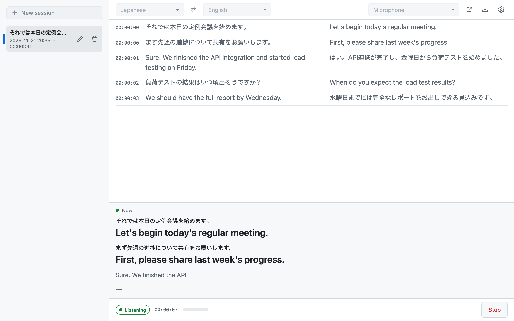

# Twinscript

English | [日本語](README.ja.md)

A desktop app for macOS and Windows that transcribes a meeting in real time and translates it between two languages.
Choose two languages and press "Start translating": Twinscript detects which one is being spoken, writes it down and shows the translation beside it.



- **Two-way**: speak in either language; no switching.
- **Hears the meeting**: transcribes the microphone, the audio playing on the computer (the other participants in Zoom, Teams, Meet), or both.
- **Captions on top**: a caption window that stays above slides and meeting apps, including full screen.
- **Keeps a record**: sessions are saved with their audio, and transcripts export with a timeline as text, Markdown, CSV or SRT.
- The interface is available in English, Japanese and Simplified Chinese.

## Install

Download the zip for your computer from [Releases](../../releases):

| File | For |
| --- | --- |
| `twinscript-<version>-mac-arm64.zip` | Mac with Apple silicon |
| `twinscript-<version>-mac-x64.zip` | Mac with an Intel processor |
| `twinscript-<version>-win-x64.zip` | Windows (64-bit) |

The app is not notarized by Apple or signed with a Windows publisher certificate, so the operating system warns the first time you open it.

- **macOS**: unzip it, move "Twinscript.app" to the Applications folder and open it.
  It shows "\"Twinscript\" Not Opened". Do not move it to the Trash; press "Done", then scroll to the bottom of
  System Settings → Privacy & Security and press "Open Anyway". After that it opens normally.
  Running `xattr -dr com.apple.quarantine "/Applications/Twinscript.app"` in Terminal does the same.
- **Windows**: right-click the zip → "Extract All" and run "Twinscript.exe" in the folder.
  If "Windows protected your PC" appears, press "More info" → "Run anyway".

Each release also has a `SHA256SUMS.txt` to check the download against. See the [code signing policy](docs/code-signing-policy.md) for the state of signing.

## Get started

1. Create a Gemini API key in [Google AI Studio](https://aistudio.google.com/apikey).
2. Open Twinscript, open the settings (gear button, top right), enter the key and save.
3. Choose the two languages and the audio input, then press "Start translating".

### Audio input

- **Microphone**: for a meeting in the room.
- **PC audio**: what is playing on the computer, for the other side of an online meeting.
- **Microphone + PC audio**: both. The microphone also picks up the speakers, so use earphones.

On macOS, PC audio needs macOS 14.2 or later and one permission: allow Twinscript in
System Settings → Privacy & Security → Screen & System Audio Recording → "System Audio Recording Only", then reopen the app.
If the permission is missing, the app tells you where to allow it.

The permissions you grant are kept when you update: every release is signed with the same certificate, so macOS
recognizes the new version as the same app. The one exception is the first update to a version signed this way
(releases before it had a different identity each time). If PC audio stays silent or macOS keeps asking after that
update, remove Twinscript from the list under "System Audio Recording Only" (and "Microphone") with the − button,
then open the app and allow it again.

### Captions on top of other apps

The caption window button (top right) moves the caption area into a frameless, translucent window that stays
on top of everything else, including full-screen slides and meeting apps. Drag it to move it; close it with ×.

The "Captions" group in settings changes it while you listen:

- **Show**: source and translation, or translation only. A sentence shows its source until its translation arrives.
  This applies to the caption area in the main window too.
- **Caption window text size**, separate from the text size of the main window.
- **Background opacity** from 0 to 100%. The text keeps a dark outline, so it stays readable over any background.
- **Click-through**: clicks go to the app underneath. While it is on, the caption window cannot be moved or closed
  with the mouse; hide it with the caption window button or the shortcut below.

In a browser the caption window is a picture-in-picture window, which is always opaque, so only the first two apply.

### Shortcuts

These work from any app while Twinscript is running, and can be turned off in settings:

| Action | macOS | Windows |
| --- | --- | --- |
| Start / stop translating | ⇧⌘T | Ctrl+Shift+T |
| Show / hide the caption window | ⇧⌘C | Ctrl+Shift+C |

If another app already uses one of them, the settings show it as unavailable. The keys cannot be changed yet.

## Sessions and storage

- The list on the left holds your sessions: create, switch, rename, delete.
- Transcripts and translations are saved automatically and are still there after you close the app.
- The audio is recorded and saved too (can be turned off in settings; about 15 MB per hour).
- The download button exports the transcript with a timeline (text / Markdown table / CSV / SRT subtitles;
  source and translation, source only, or translation only) and the recordings.
- Everything is stored on your computer, inside the app. Nothing is synced anywhere.

## Privacy

Twinscript has no server. Audio and text go directly from your computer to Google's Gemini API with your own API key,
which is stored on your computer, encrypted by the operating system (the Keychain on macOS, DPAPI on Windows). If the
system cannot encrypt it, the key is not saved and the app asks for it again the next time.

On macOS the encryption key lives in the Keychain, in an item named "Twinscript Safe Storage". If macOS asks whether
Twinscript may use it, choose "Always Allow"; the app uses it only to read and save your API key.

- On Gemini's free tier, what you send is used to improve Google's products. Use a paid key for confidential meetings.
- Recording or transcribing other people may require their consent.

## Pricing

- **Free tier**: both models work on it. It is rate-limited.
- **Paid tier** (a key linked to Google Cloud billing): transcription costs about $0.009 per minute (about $0.54 per hour)
  plus a small token fee for translation. What you send is not used for training.

## Limitations

- It cannot tell speakers apart (who said what).
- A transcription session lasts at most 10 minutes, so the app switches to a new connection in the background, at a pause in speech.
- When the free tier hits its rate limit, translation of sentences in progress pauses for a minute; finished sentences are still translated.
- Recordings (WebM) carry no duration information, so some players cannot seek in them.

## How it works

| Role | Model |
| --- | --- |
| Transcription (streaming, with interim results) | Gemini Live API `gemini-3.5-transcribe-live` |
| Translation (streaming) | `gemini-3.5-flash-lite` (can be changed in settings) |

The app is built with web technology and packaged with Electron.

## Development

```sh
npm install
npm run app        # run the desktop app
npm run dist:mac   # macOS zips in dist/ (Apple silicon / Intel)
npm run dist:win   # Windows zip in dist/ (x64)
```

Releases are built and published automatically when a change to the app lands on `main`.

The interface also runs in a browser, which is convenient while developing:

```sh
npm start          # http://localhost:5173
```

`http://localhost:5173/?mock=1` is a demo mode that needs no API key. In a browser, PC audio comes from sharing a tab or
screen with its audio, and the caption window is a picture-in-picture window (Chrome and Edge). The API key entered
there is kept in memory only, until the page is closed.

### Tests

```sh
npm test          # unit tests, no dependencies
npm run test:e2e  # browser tests with the installed Chrome and a fake microphone
npm run test:app  # desktop app smoke tests; they open real windows
```

The Gemini API is mocked in all of them, so no API key is needed.

## Contributing

See [CONTRIBUTING.md](CONTRIBUTING.md). To report a security problem, see [SECURITY.md](SECURITY.md).

## License

[MIT](LICENSE)

The UI uses design tokens from Primer Primitives and icons from Octicons (both MIT, © GitHub Inc.); see [THIRD-PARTY-NOTICES.md](THIRD-PARTY-NOTICES.md).
